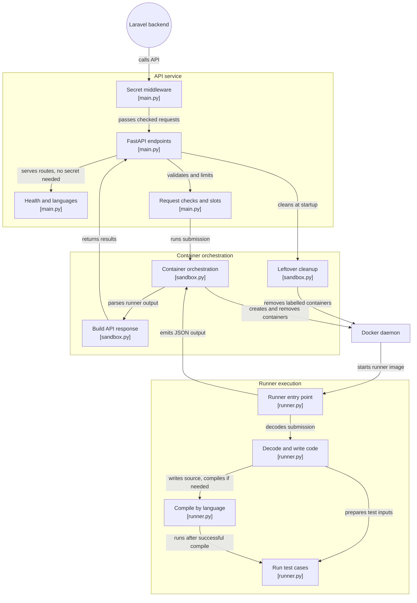

# algosproj-sandbox

Runs user-submitted code for AlgosLab, a platform for learning data structures and
algorithms. It takes code plus test cases, runs them in a throwaway Docker container, and
returns the results as JSON. Only the Laravel backend (`algosproj-backend`) calls this
service, using a shared secret; it is never exposed to the public internet.

## Architecture

A request passes the secret check, then the limits and a free run slot, and runs in a fresh runner container.



## Stack

Python, FastAPI, Docker SDK for Python. One runner image (`algosproj-runner`) holds every
language.

## Languages

| Language     | Source file | Compile                                    | Run                                |
|--------------|-------------|--------------------------------------------|------------------------------------|
| `python`     | `main.py`   | none                                       | `python3 main.py`                  |
| `java`       | `Main.java` | `javac Main.java`                          | `java -Xmx128m -Xss512k Main`      |
| `javascript` | `main.js`   | none                                       | `node main.js`                     |
| `cpp`        | `main.cpp`  | `g++ -O2 -std=c++17 -o main main.cpp`      | `./main`                           |

**Java: the class must be named `Main`** (`public class Main`), because the file is saved
as `Main.java`.

Programs read the test input from stdin and print the answer to stdout. Output and
expected output are compared after stripping leading and trailing whitespace.

## Setup

Build the runner image first (needed again whenever `runner/` changes):

```bash
docker build -t algosproj-runner runner
```

Then run the service:

```bash
python -m venv venv
venv\Scripts\activate
pip install -r requirements.txt
copy .env.example .env   # then set a real SANDBOX_SECRET
uvicorn app.main:app --reload --port 8001
```

The backend also defaults to port 8000, which is why the example uses `--port 8001`.

## Docker

> **Warning: local development only.** The service starts runner containers through the
> Docker API, so this setup mounts `/var/run/docker.sock`, which gives the container
> root-level control of the host. In production, run the sandbox service directly on a
> dedicated VPS (or with rootless Podman), not as a container with the socket mounted.

The image holds only the API; build the runner image separately (see Setup). No `.env`
is copied into the image; pass configuration as environment variables.

```bash
docker build -t algosproj-sandbox .
docker run --rm -p 8001:8001 -e SANDBOX_SECRET=your-secret \
  -v /var/run/docker.sock:/var/run/docker.sock --group-add 0 algosproj-sandbox
```

The service runs as a non-root user, so `--group-add` must give it the socket's group:
`0` on Docker Desktop, or `$(stat -c %g /var/run/docker.sock)` on a Linux host. From Git
Bash on Windows, prefix the command with `MSYS_NO_PATHCONV=1` so the socket path isn't
rewritten.

Environment variables: `SANDBOX_SECRET` (required), `SANDBOX_MAX_RUNS` and `SANDBOX_DOCS` (optional, see below).

## Tests

The tests start the service and run code in real Docker containers, so Docker must be
running and the image must be built:

```bash
python -m pytest tests -v
```

## Environment variables

- `SANDBOX_SECRET`: shared secret; requests must send it in the `X-Sandbox-Secret` header.
  Read from `.env` if it isn't set in the environment. It is checked (constant-time) before the
  request body is read; every path except `/health` and `/languages` needs it, and with no secret
  configured every such request gets 401.
- `SANDBOX_MAX_RUNS` (default `4`): at most this many runs at the same time. When every slot is busy,
  `/run` answers `503` `{"detail": "Sandbox busy"}` with `Retry-After: 5` at once (no queue); the
  backend turns that into its "code runner unavailable" 503.
- `SANDBOX_DOCS`: `1` turns on FastAPI's `/docs`, `/redoc` and `/openapi.json` for local development.
  Off by default (404).

All variables can also be set in `.env`; real environment variables win.

## API

- `GET /health` returns `{"status": "ok"}`
- `GET /languages` returns `{"languages": ["python", "java", "javascript", "cpp"]}`
- `POST /run`, with the `X-Sandbox-Secret` header:

```json
{"language": "python", "code": "print(int(input()) * 2)",
 "test_cases": [{"input": "21", "expected_output": "42"}]}
```

Response:

```json
{"status": "passed", "results": [{"passed": true, "actual": "42", "expected": "42", "error": null}],
 "runtime_ms": 35, "compile_error": null}
```

`status` is one of:

- `passed`: every test passed
- `failed`: the program ran, but some output was wrong
- `error`: a compile error (in `compile_error`), or the program crashed on a test (syntax
  error in Python/JavaScript, exception, out of memory; message in `results[].error`)
- `timeout`: a test took longer than 3 s, or the whole run took longer than 40 s

Errors: `401` wrong or missing secret, `400` unknown language, `413` code over 64 KB, more
than 50 test cases, or code plus test cases too big to pass to the container (about
120 KB encoded), `422` malformed body, `503` every run slot busy (`Retry-After: 5`).

A run with no test cases is never `passed` (the backend refuses such a problem before calling).

## Limits

Every run gets its own container, removed afterward: no network, 256 MB memory with no
swap, 64 processes/threads, one CPU, read-only filesystem except a 64 MB `/tmp`, user
`nobody` with no capabilities and `no-new-privileges`, and no file larger than 10 MB (`fsize`
ulimit). Compiling may take 30 s, each test 3 s, and the whole container 40 s.

Run containers carry the label `algosproj.sandbox=runner`. When the service starts it removes any
container with that label (left over after a crash); containers without it are never touched. So run
only one sandbox process per Docker host.
